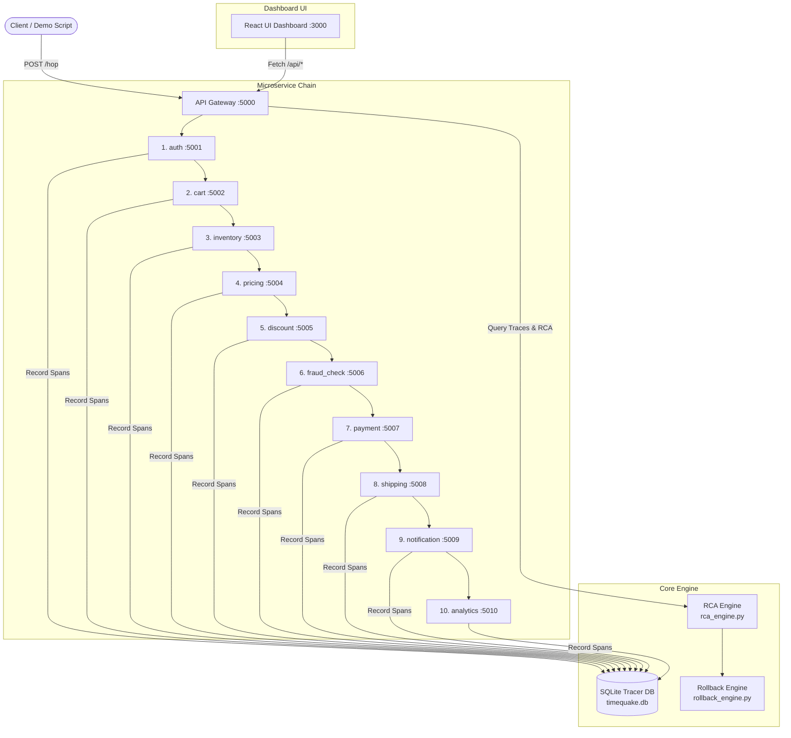

# ⚡ TimeQuake: Distributed Microservices Time-Travel Debugger & Causal RCA Engine

[](https://www.python.org/)
[](https://flask.palletsprojects.com/)
[](https://reactjs.org/)
[](#license)

**TimeQuake** is an enterprise-grade distributed microservices platform, telemetry engine, and time-travel debugger. It features automated **Causal Graph Root-Cause Analysis (RCA)**, statistical **Z-Score anomaly detection**, and **Saga compensating rollback tracking** across multi-tier microservice dependency chains.

---

## 🌟 Key Features

- **10-Node Microservices Pipeline**: Realistic ecommerce workflow spanning `auth` ➔ `cart` ➔ `inventory` ➔ `pricing` ➔ `discount` ➔ `fraud_check` ➔ `payment` ➔ `shipping` ➔ `notification` ➔ `analytics`.
- **Distributed Telemetry & Context Propagation**: Transparent propagation of `X-Trace-Id` and `X-Parent-Span-Id` correlation headers across all service hops.
- **Statistical Z-Score Anomaly Detection**: Dynamically calculates per-service self-time baselines (mean & standard deviation) to spot abnormal latency spikes ($Z > 2.0$).
- **Causal Graph Root-Cause Isolation**: Differentiates between the **True Root-Cause Service** (where unexpected latency originated) and **Downstream Cascading Symptoms** (services whose overall duration inflated due to waiting on downstream calls).
- **Advanced Live Fault Control**: Arm a delay for one to 25 upcoming requests reaching any already-running service through `POST /api/fault` or the dashboard—either dispatch immediately or wait for natural traffic. No startup flag, config edit, or restart is required.
- **Durable Saga Rollbacks & State Snapshots**: Writes one SQLite `rollbacks` row for every upstream ancestor and records each affected service's before/during/after state as a durable `service_state_events` timeline.
- **Interactive Time-Travel Visual Dashboard**: React + Vite UI with task-manager-style live service activity, per-service z-score panels, database-driven rollback markers, causal graphs, and a state-restoration playback control.

---

## 🏗 System Architecture



---

## 🚀 Quick Start

### Prerequisites

- **Python 3.8+**
- **Node.js 16+** & `npm`

### 1. Installation

Clone the repository and install the backend and frontend dependencies:

```bash
# Install Python backend dependencies
pip install -r requirements.txt

# Install Frontend UI dependencies
cd frontend
npm install
cd ..
```

---

## 🏃 Running the Application

### Option A: Using Python Orchestrator (Cross-Platform)

Run the Python service manager which launches all 10 microservices, the API gateway, and the frontend dev server concurrently:

```bash
python run_services.py
```

### Option B: Using Shell Script (Linux / macOS)

```bash
chmod +x run_all.sh
./run_all.sh
```

### Option C: Using Batch Script (Windows)

```bash
run_all.bat
```

Once running:
- 🌐 **Dashboard UI**: [http://localhost:3000](http://localhost:3000)
- 🔌 **API Gateway**: [http://localhost:5000](http://localhost:5000)
- ⚙️ **Microservices**: Ports `5001` through `5010`

---

## 🧪 Simulation & Traffic Generation

Generate baseline traffic and optionally arm a live artificial fault using `simulate.py`:

```bash
# Generate 20 normal baseline requests to populate latency metrics
python simulate.py --normal 20

# Arm a fault in the already-running inventory service, then perform Causal RCA
python simulate.py --fault inventory

# Skip baseline generation and run a single live-fault test with a 2-second delay
python simulate.py --single --fault cart --delay-ms 2000
```

### Running Verification Tests

To run automated integration tests verifying health checks, API endpoints, and fault injection:

```bash
python verify.py
```

---

## 📡 API Gateway Reference

The API Gateway runs on port `5000` and provides the following REST endpoints:

| Endpoint | Method | Description |
| :--- | :--- | :--- |
| `/hop` | `POST` | Entry-point for forwarding a normal request through the running microservices chain. |
| `/api/fault` | `POST` | Arms `{ "service": "payment", "delay_ms": 1500, "request_count": 2 }` for upcoming requests reaching that already-running service. |
| `/api/fault` | `GET` | Lists any armed but not-yet-consumed live faults. |
| `/api/chain` | `GET` | Returns configured service chain sequence and default latency ranges. |
| `/api/health` | `GET` | Aggregated real-time health status, request counts, and uptime for all 10 services. |
| `/api/traces` | `GET` | List of recent trace IDs, timestamps, initiating services, and fault-run flags. |
| `/api/trace/<id>` | `GET` | Full causal graph breakdown plus persisted rollback rows for a specific trace. |
| `/api/trace/<id>/rollbacks` | `GET` | Query persisted rollback rows and their `pending`/`completed` statuses. |
| `/api/trace/<id>/state-history` | `GET` | Query persisted before/after service-state snapshots for trace and rollback playback. |
| `/api/anomalies` | `GET` | Per-service z-score time-series data across recent traces. |
| `/api/incidents` | `GET` | Chronological log of detected incidents, root-cause flags, and plain-English diagnostic explanations. |

---

## ⚙️ Configuration (`chain_config.json`)

Customize the microservice chain and expected normal latency distributions (in milliseconds) in `chain_config.json`. Faults are deliberately not configured here; they are armed against live services through the API or dashboard:

```json
{
  "services": [
    "auth", "cart", "inventory", "pricing", "discount",
    "fraud_check", "payment", "shipping", "notification", "analytics"
  ],
  "default_latency_ranges_ms": {
    "auth": [20, 50],
    "cart": [30, 60],
    "inventory": [40, 80],
    "pricing": [20, 40],
    "discount": [20, 40],
    "fraud_check": [50, 100],
    "payment": [60, 120],
    "shipping": [30, 50],
    "notification": [15, 30],
    "analytics": [20, 40]
  },
  "trace_id_header": "X-Trace-Id",
  "parent_span_id_header": "X-Parent-Span-Id"
}
```

---

## 📂 Project Structure

```
timequake/
├── api.py                   # API Gateway (Port 5000) & REST endpoint definitions
├── rca_engine.py            # Causal Graph RCA, Self-Time & Z-Score Anomaly Engine
├── rollback_engine.py       # Saga pattern compensating transaction tracker
├── tracer.py                # SQLite telemetry span recorder (timequake.db)
├── run_services.py          # Python cross-platform service orchestrator
├── simulate.py              # Demo traffic generator & fault injection CLI
├── verify.py                # Automated end-to-end testing script
├── chain_config.json        # Centralized microservices chain configuration
├── requirements.txt         # Python package requirements
├── services/
│   └── service_node.py      # Generic microservice Flask node (Ports 5001-5010)
└── frontend/                # React + Vite dashboard UI
    ├── src/
    │   ├── App.tsx          # Main live dashboard, per-service charts, and causal graph UI
    │   └── main.jsx         # React application entrypoint
    └── package.json         # Frontend dependencies & scripts
```

---

## 📄 License

This project is licensed under the MIT License.
